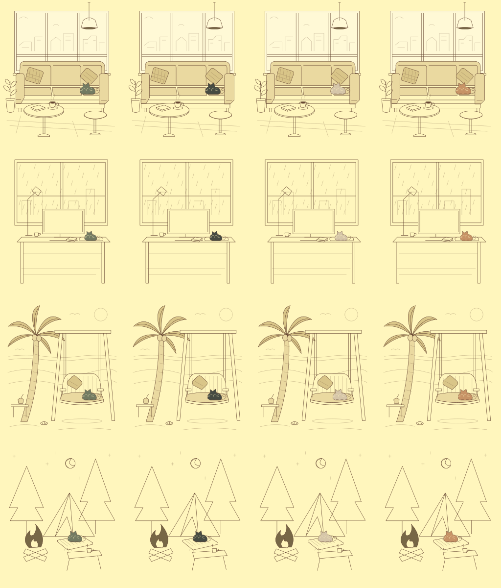

# life.ing｜第二天场景与猫咪定位

日期：2026-10-31。已完成本地实现与 SVG 静态视觉检查，尚未提交、推送或发布。

- 原四场景及四猫 ID 保持不变，旧设置继续适用。
- 新增 SCENE_LAYOUTS，按统一 640×750 坐标系记录脚底锚点、缩放及落脚处。猫咪动画保留在内层，定位变换位于外层。
- 咖啡馆：猫咪落在沙发右侧坐垫。
- 雨夜：猫咪放在桌面右侧软垫；新增书本细节，杯子移至电脑左侧，避免与猫咪重叠。
- 海边：按用户后续意见改为海边秋千椅与椰子树；保留海浪、太阳、贝壳和小桌，猫咪落在秋千坐垫右侧。
- 营地：帐篷口增加编织软垫，猫咪远离篝火；长凳旁增加杯子。
- SVG 可读名称包含场景、猫咪和落脚处；无效场景和猫咪 ID 使用已有默认值。

## 验证

四场景×四猫共 16 组已使用 SVG 渲染图检查支撑关系、颜色与画布边界。预览顺序：从上到下为咖啡馆、雨夜、海边、营地；从左到右为小黑、煤球、奶糖、橘子。

代码检查、现有九项测试、静态构建均通过。未新增运行时依赖。预览图使用现有本地 sharp 工具生成，不进入站点资源。

本轮未做浏览器真机验收；SVG 使用统一 viewBox，场景和猫咪一起缩放，现有响应式规则未改变。完整桌面/手机页面的布局及交互复验仍列入第五、六天。淡入淡出和猫咪随番茄钟切换姿态安排在第三天，本轮不标为完成。
