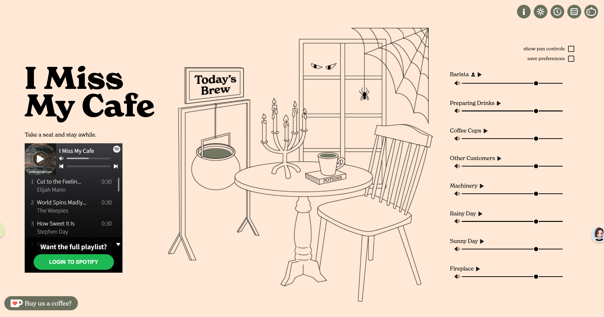

# life.ing｜生活进行时 项目需求说明书 V2

> 2026-10-31 基线校正：本文保留完整 V2 目标；当前静态初版范围和实现状态以 [第一天基线](DAY-1-BASELINE.md) 和 [静态发布说明](STATIC-RELEASE.md) 为准。品牌已更名；音乐区采用当前粉色主题。下文蓝色要求、合成音描述属于旧阶段；真实录音已接入。QQ 站内播放、云端与每场景六轨仍为未完成目标。

修订日期：2026-10-29。

本版保留 I Miss My Cafe 的简洁三分区布局；最新修订为嫩黄色背景、咖啡色线条、蓝色音乐区，咖啡馆参考 Peet’s 窗边沙发休息区原创重绘。左侧必须在官方授权后直接控制播放；右侧声音按场景配置，右上角唤出待办。

本文件为当前需求基准，替代旧版的首页布局和开发优先级。历史原文保存在 [V1](PROJECT-REQUIREMENTS-V1.md)。V1 中未冲突的功能、安全及隐私要求继续有效。2026-10-29 用户已指定 QQ 音乐优先，后续增加 Spotify / QQ / 网易云切换。实现及验证状态见[开发进度](DEVELOPMENT.md)，本文件的需求清单不代替交付记录。

## 1. 产品定位与范围

life.ing（生活进行时）是一个以音乐、环境音和场景陪伴为核心的轻量专注网页。

核心流程：打开页面 → 选择或连接音乐 → 调整环境音 → 按需唤出待办或番茄钟 → 安静工作。

原有四场景、猫猫、账号、多人房间、共享/私人歌单和历史热力图继续保留，通过工具入口或后续阶段交付，不在首页铺开。完整产品范围未因首页简化而取消。

## 2. 视觉与布局基准

主要基准为用户提供的[布局参考图](references/layout-reference.png)。官网参考：[I Miss My Cafe](https://imissmycafe.com/)。视觉要求来自截图，不假定已核实参考网站的所有交互。

### 2.1 桌面首屏

采用全屏三分区构图，右上放紧凑工具图标，默认首屏不展示任务卡片和大型计时器。

| 区域 | 内容 | 布局与交互要求 |
| --- | --- | --- |
| 左侧 | 大号多行品牌标题、短介绍、音乐播放器、连接账号及更换音乐入口 | 参考图纵向排布；播放器紧接介绍，音乐始终可直接使用 |
| 中央 | 大幅细线场景插画、少量环境动画、融入场景的猫猫 | 占据视觉中心，场景主体完整；功能模块不长期遮挡插画 |
| 右侧 | 纵向声音列表，每项播放/暂停、音量滑杆 | 常驻，直接调节；不需要先打开设置 |
| 右上角 | 介绍、主题/场景、番茄钟、待办及更多入口 | 小型圆形图标；待办必须一键到达，其他功能收纳 |

桌面初始宽度比例建议约左 25%、中 47%、右 28%，属于实施起点；最终以参考图构图、标题尺度、插画大小、列表密度和留白验收。

### 2.2 视觉风格

- 浅色主题采用嫩黄色背景（#fff6bd）、咖啡色细线/标题（#654531），左侧音乐区为蓝色（#2f5e94）。
- 品牌为 life.ing，中文副标题为“生活进行时”；其他文字以简短中文为主。
- 高度复刻截图的区域位置、尺寸关系、留白及工具层级，替换当前深色顶部横栏与下方三张功能卡布局。
- 场景采用统一线稿风格，咖啡馆改为 Peet’s 窗边软沙发、靠垫、低圆桌和绿植的休息区方向；移除菜单架/烛台/高背椅构图，不复用参考站点的插画。四场景切换保持页面结构。
- 插画、字体、图标和声音使用自制或可用授权素材。截图里的蜘蛛网等季节装饰、打赏入口、第三方悬浮头像不自动成为功能需求。

### 2.3 响应式

- 桌面建议 1200px 及以上完整呈现三分区，在参考图比例、1440×900、1920×1080 下对照检查。
- 平板缩小标题和插画，保持播放器、滑杆可操作。
- 手机保留场景与右上工具，音乐/声音改成可切换面板；不强压三列。该规则为移动端实现建议。
- 小高度视口允许面板内部滚动，不能裁掉声音项目或播放器控件。展开的工具面板不能超出视口。

## 3. 左侧音乐与个人音乐账号

### 3.1 常驻音乐区

- 品牌简介下方显示当前歌曲/歌单、平台、真实可用的播放控制。
- 支持粘贴歌曲或歌单链接；输入表单由“更换音乐”按需唤出。
- 音乐音量与右侧环境音独立；调整雨声不改变音乐音量。
- 切场景、打开待办或番茄钟时，不销毁播放器或重新加载歌曲。
- 未选择音乐时展示简短引导，失败时给出可执行的恢复操作。

### 3.2 登录自己的账号

左侧提供“连接音乐账号”，进入音乐平台官方登录/授权流程，使用用户已有的平台账号。连接音乐不要求先注册本站账号。

| 能力 | 用户结果 | 验收定义 |
| --- | --- | --- |
| 官方播放器/平台登录 | 在官方播放器或官方页面登录后播放所选音乐 | 登录发生在平台控制的界面；返回后保留本站场景、任务和音量 |
| 连接个人音乐库 | 授权本站访问允许范围内的个人资料/歌单 | 真实授权后展示连接状态，选择授权范围内的个人歌单，并可断开或重新授权 |

正式验收必须为：QQ 官方授权后返回本站，在左侧选择自己的歌单并实际播放、暂停、切歌、调进度与音量。仅保存链接、打开外部页面或完成普通 QQ 登录都不算完成。用户尚未申请官方应用，当前真实授权和播放保持待接入，见 [申请步骤](QQ-MUSIC-ACCESS.md)。

### 3.3 平台策略及限制

- 用户已指定先接入 QQ 音乐；目标为站内授权与直接控制。官方页面外链只保留为临时回退，不能算交付完成。
- 平台适配结构预留 Spotify、QQ、网易云，后续开放三平台切换；当前只开放 QQ，不展示尚未接入的平台切换按钮。
- Spotify 支持歌曲、歌单等官方嵌入；个人资源访问使用 OAuth，浏览器应用可采用 Authorization Code with PKCE。[嵌入说明](https://developer.spotify.com/documentation/embeds/tutorials/creating-an-embed)、[授权说明](https://developer.spotify.com/documentation/web-api/concepts/authorization)。
- Spotify 站内音频播放 SDK 需要个人 Premium 账号的访问令牌；登录成功不等于任何账号都能在本站完整播放。[官方 SDK 入门](https://developer.spotify.com/documentation/web-playback-sdk/tutorials/getting-started)。
- 实施前验证应用注册、回调、权限、测试用户/公开使用范围、账号及浏览器条件，记录可复现结果。未通过时标记该项未交付，不用空按钮充当完成。
- 嵌入或播放失败时可“在原平台打开”；该回退保证可用，但不等于已通过站内完整播放或个人歌单接入验收。
- 第三方播放器内部样式由平台控制，允许原生外观；外部位置和尺寸遵循参考布局。
- 不收集音乐平台密码、不索取用户 Cookie、不抓取受保护音频。Token 不写入日志、分享链接或房间广播。

### 3.4 状态与两类账号

- 官方授权连接至少有：未连接、授权中、已连接、过期、拒绝、失败。只有真实完成授权才能显示已连接。
- 官方页面登录模式不推断本站无法读取的平台会话。断开本站连接时清除本站持有的凭据，不宣称退出了平台会话。
- 本站账号用于云端任务、房间和历史数据；音乐平台账号用于音乐，两者独立。连接音乐不自动成为本站登录方式。

## 4. 右侧环境声音

### 4.1 按场景组织声音

右侧保持“名称 + 播放/暂停 + 横向音量滑杆”，每场景六条合理音轨。

| 场景 | 六条可调声音 |
| --- | --- |
| 窗边沙发咖啡馆 | 远处轻谈、咖啡机、杯碟、冲泡、店内脚步、门铃 |
| 雨夜工作台 | 细雨、远雷、键盘、房间底噪、翻书、白噪声 |
| 晴天海边 | 海浪、海风、远处海鸥、风铃、沙滩掠风、浅滩水声 |
| 篝火旁 | 木柴噼啪、虫鸣、树叶、远处猫头鹰、帐篷、林间夜风 |

开放录音优先筛选 CC0 / CC BY，逐条记录来源和许可；来源面板区分实际采用与候选。当前仍为合成音景，见[音源计划](AUDIO-SOURCES.md)。

### 4.2 播放与设置

- 每项独立播放/暂停、0—100% 音量，可同时播放多项；暂停保留音量。
- 提供“环境音静音”，不静音音乐；所有音轨必须真实可听，不能只改变文案。
- 某音轨加载失败只影响对应行，提示可重试，不阻塞其他声音与任务。
- 顶部提供“保存声音偏好”，保存启用音轨与音量；恢复配置后等待用户操作解锁播放，不强制自动出声。
- 声像控制为增强项，默认隐藏，通过开关显示。
- 切场景应用预设，优先恢复该场景的个人保存配置；音量变化平滑，私人音乐不受影响。
- 房间可提供预设，本地播放开关与音量由本人控制，不覆盖个人配置。

## 5. 右上工具与待办

### 5.1 工具栏

介绍、主题/场景、番茄钟、待办可直接到达；账号/我的、猫猫、房间和其他设置放入“更多”。具体图标可微调，但不堆叠所有功能。

图标悬停或聚焦显示名称，有可读名称和足够点击范围；激活状态不能仅靠颜色表示。

### 5.2 待办浮层

- 默认收起；点右上角待办图标，在右上方唤出锚定浮层，不跳转、不推挤场景布局。
- 展示今日待办、新增输入、完成勾选、删除、完成数量，可选择当前专注任务。
- 新增、完成/取消完成、明确删除；标题必填，本版采用上限 120 字符。
- 再点图标、点击外部、Escape 均可收起；关闭后焦点回到入口，任务、音频、计时不丢失。
- 临时遮挡部分右侧声音区域可以接受，关闭后恢复首屏。若采用模态需焦点约束；非模态不得错误锁住其他控件。
- 访客本地保存；登录后按明确策略合并，账号之间隔离。默认显示当天，跨日不删除历史任务。
- 保留 V1 的任务时间字段、专注关联及统计要求；默认不向房间广播任务标题。

### 5.3 番茄钟浮层

- 点击独立计时图标唤出，支持 25 分钟专注、5 分钟短休息、15 分钟长休息及自定义。
- 开始、暂停、继续、重置；与待办默认一次只展开一个工具面板。
- 收起或切换面板不暂停计时，图标旁显示紧凑剩余时间；后台恢复按截止时间校正。
- 专注完成时猫猫起身、喵叫、提示与计数仅触发一次，提供开始休息/继续专注。
- 猫叫和动画可独立关闭；休息结束不增加完成番茄数。

## 6. 原有功能的保留方式

| 功能 | V2 的入口与表现 |
| --- | --- |
| 四场景 | 主题/场景面板选择 rainy-room、sunny-beach、campfire、cafe，建议默认咖啡馆；保留三分区结构 |
| 四猫猫 | 通过更多/设置选择小黑、煤球、奶糖、橘子，以线稿风格融入场景；个人选择独立 |
| 本站账号 | 账号入口登录/注册，沿用昵称密码、记住登录和安全 Session，不强制登录使用首页 |
| 多人房间 | 更多/房间入口；保留房间码、成员状态、共享场景、共同开始、权限与断线恢复 |
| 私人/共享歌单 | 左侧音乐区切换个人/房间来源；默认私人，不广播个人音乐凭据或私人歌单 |
| 我的与热力图 | 账号/我的进入次级视图，保留 365 天每日汇总，不占首页中央 |

V1 账号、数据表、房间、权限、安全与隐私、每日活动规则继续有效。平台枚举扩展为 spotify / netease / qq / other，授权连接与普通链接独立建模。

V1“不做第三方登录”指本站身份登录，不排除本版新增的音乐平台授权。

## 7. 开发阶段与优先级

| 阶段 | 内容 | 完成门槛 |
| --- | --- | --- |
| A：首页布局与声音 | 三分区、浅色线稿、图标工具、右侧真实混音、待办浮层及本地保存 | 对齐截图；声音和待办可实际使用 |
| B：个人音乐与专注 | 左侧播放器、至少一个平台官方账号登录、个人歌单授权验证及接入、番茄钟与猫猫反馈 | 真实账号路径可复现；明确个人库/播放能力，不以仅外链冒充 |
| C：完整单机 | 四场景、四猫猫、配置、移动端、无障碍、旧数据迁移 | 切场景不丢任务，不打断音乐或计时 |
| D：账号与多人 | 本站会话、云端同步、房间、权限、共享歌单 | 双账号隔离、双浏览器同步与断线恢复 |
| E：我的与统计 | 设置、专注统计、365 天热力图 | 每日汇总准确且本人可见 |

音乐账号能力前移至 B，不再等旧 Phase 4；当前排期以本表与[V2 开发清单](REQUIREMENTS-BACKLOG.md)为准。

## 8. 验收清单

- [ ] 默认首屏为左侧标题/音乐、中间线稿场景、右侧声音、右上工具。
- [ ] 浅色主题为嫩黄底、咖啡色线条、蓝色音乐区；咖啡馆是原创窗边沙发构图，三分区与留白保持简洁。
- [ ] 不出现常驻的任务/计时/猫猫三张卡片，不需向下滚动才能找到核心音频控制。
- [ ] 四场景各六条合理声音，可播放、逐项调节、混音、静音、保存偏好；来源与实际采用状态透明。
- [ ] QQ 官方授权后可在左侧直接控制实际播放、暂停、切歌、进度与音量；外部登录不算完成。
- [ ] 若提供个人歌单连接，真实授权后展示允许的个人内容，支持取消、过期、重连、断开。
- [ ] 记录实际平台、账号条件、接入模式、个人库能力与播放限制；不能用保存 URL 冒充账号接入。
- [ ] 右上待办一键唤出/收起，默认收起，增删、完成/取消与保存均可用。
- [ ] 打开、关闭、切换工具不会重置任务、播放器或计时。
- [ ] 番茄钟完整运行，猫猫完成动画和喵叫可用，二者可独立关闭。
- [ ] 四场景维持布局和线稿风格，切换不影响私人音乐、任务和当前计时。
- [ ] 手机面板、键盘、焦点、音频失败回退可用。
- [ ] 云端、房间、歌单和热力图满足 V1 对应权限及隐私要求，并保持首页简洁。

## 9. 实施前待定事项

1. 首选音乐平台已确定为 QQ 音乐；站内个人库所需的官方应用接入、授权与凭据尚待落实。
2. 账号体验目标：官方页面登录后播放，还是直接在本站选择个人歌单并播放。后者为个人库连接完整目标，外链回退不能静默替代。
3. 最终插画与声音素材，确认可用资源后才能进行视觉及音频验收。

未定项不影响三分区、右侧混音和右上待办的需求确定；最终音乐平台会影响授权及播放实现。
